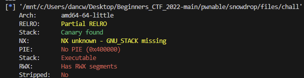
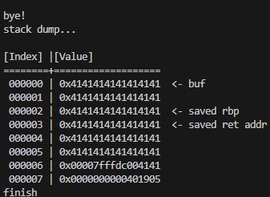

# snowdrop
144 points

snowdrop is similar to the previous challenge raindrop. However, notably, there is not `help()` function that calls `system@plt` for us.

Start with `checksec` to see what defenses are being used.

Interestingly, this seems to be a shellcode challenge instead of a rop challenge like raindrop. I assumed that because raindrop had more solves, it was easier. I assume that this is a shellcode challenge because `checksec` tells us that the stack is executable. 

Let's begin by building a payload of 50 "A"s. Doing so gives us:

Presumably, we find/write shellcode for `system("sh")`, put it on the stack, and overwrite the return address with address of our shellcode.